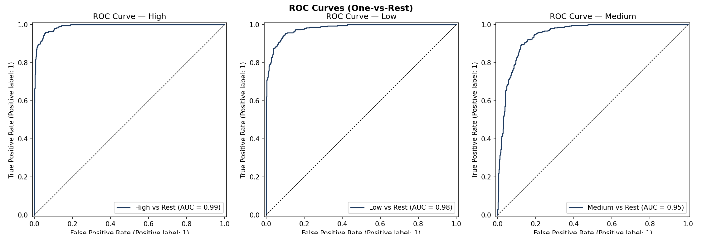
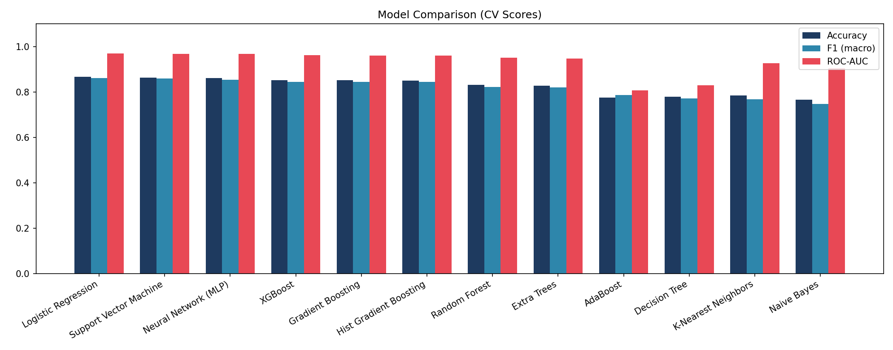
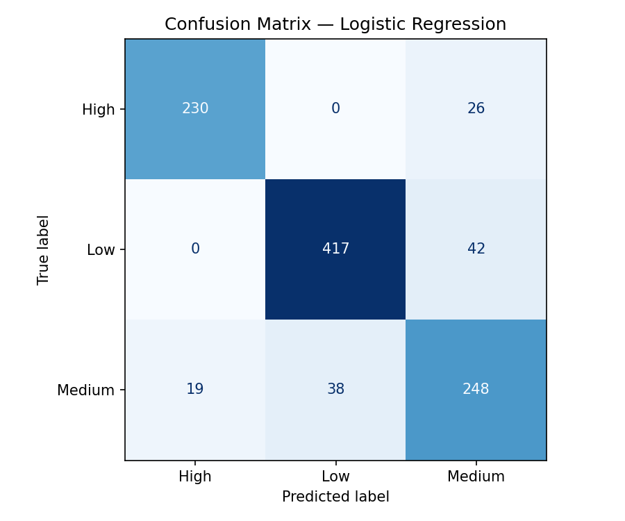
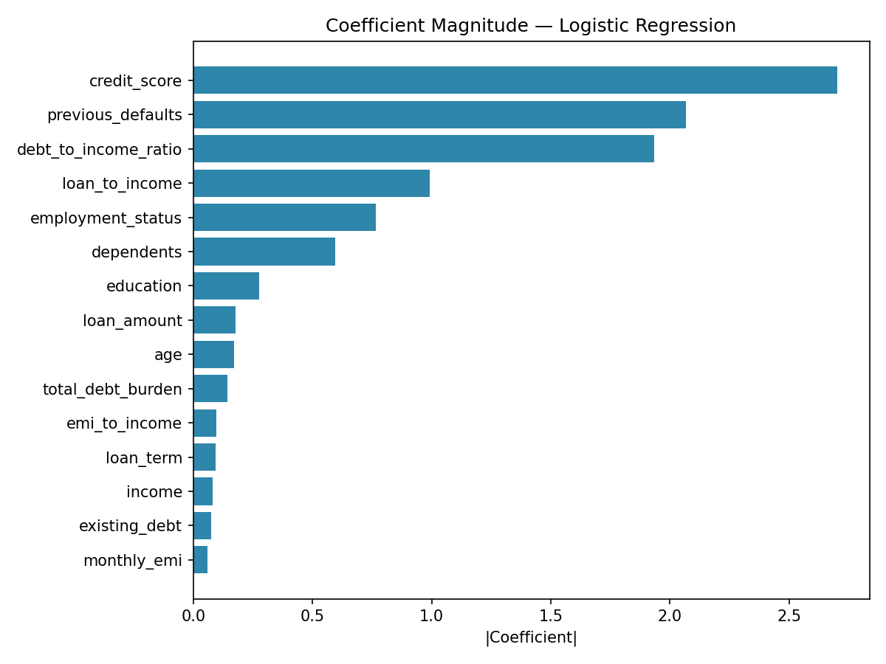
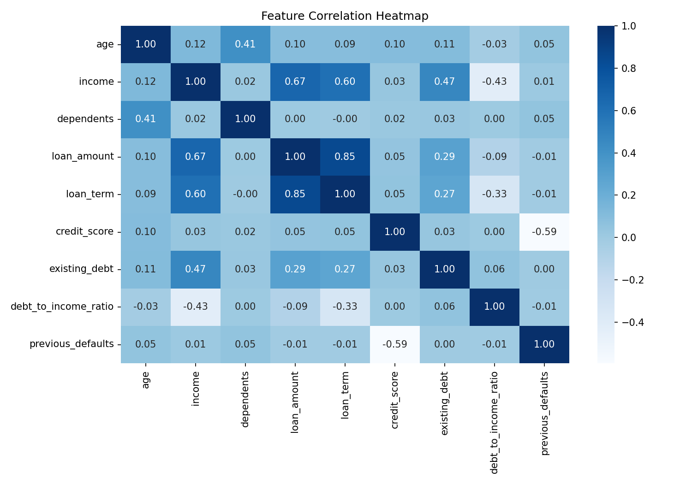

# LoanIQ Risk: Loan Risk Prediction

A machine learning system that classifies loan applicants as **Low, Medium, or High risk**. It benchmarks 12 models, explains each prediction, and ships as an interactive Streamlit app with batch scoring, a what-if simulator, model consensus, and PDF reports.

**Live demo:** https://loaniq-risk.streamlit.app



## Highlights

- 15 model features (9 numeric, 4 engineered ratios, 2 categorical) on a 5,098-record dataset, 3 risk classes
- 12 models benchmarked with cross-validation
- Best model: Logistic Regression, 86.59% CV accuracy and 0.9687 CV ROC-AUC (5-fold)
- Dataset note: 5,000 synthetic rows (`src/generate_data.py`) plus 98 hand-made records
- Interactive app with 5 modules, built with Streamlit

## Features

- **Assess applicant:** enter details and get a risk class with probabilities and an explanation
- **Batch scoring:** upload a CSV, validate it, estimate missing income and debt-to-income ratio, choose a model, and download the scored CSV
- **What-if simulator:** live sliders show how the risk changes against a baseline, and what would move an applicant to Low risk
- **Model consensus:** all 12 models vote; the app shows majority vote, agreement level, and a warning when models disagree
- **PDF assessment report:** one-click report built with ReportLab and Matplotlib

## Model benchmark

Cross-validated results on all 12 models (from `reports/model_comparison.csv`):

| Model | CV Accuracy | CV F1 (macro) | CV ROC-AUC |
|---|---|---|---|
| Logistic Regression | 0.8659 | 0.8619 | 0.9687 |
| Support Vector Machine | 0.8624 | 0.8593 | 0.9674 |
| Neural Network (MLP) | 0.8605 | 0.8539 | 0.9666 |
| Gradient Boosting | 0.8516 | 0.8447 | 0.9595 |
| XGBoost | 0.8512 | 0.8451 | 0.9609 |
| Hist Gradient Boosting | 0.8507 | 0.8447 | 0.9596 |
| Random Forest | 0.8315 | 0.8217 | 0.9502 |
| Extra Trees | 0.8283 | 0.8208 | 0.9475 |
| K-Nearest Neighbors | 0.7847 | 0.7684 | 0.9255 |
| Decision Tree | 0.7793 | 0.7711 | 0.8291 |
| AdaBoost | 0.7749 | 0.7864 | 0.8066 |
| Naive Bayes | 0.7651 | 0.7473 | 0.9039 |

Logistic Regression gave the best balance of accuracy and generalization, and was tuned for the final model.

## Charts

| Model comparison | Confusion matrix |
|---|---|
|  |  |

| Feature importance | Correlation heatmap |
|---|---|
|  |  |

## Tech stack

Python · scikit-learn · XGBoost · Pandas · NumPy · Streamlit · Plotly · Matplotlib · Seaborn · ReportLab · Joblib

## Run locally

```bash
git clone https://github.com/24B11CS433vivek/loan-risk-prediction.git
cd loan-risk-prediction
python3 -m venv .venv
source .venv/bin/activate
pip install -r requirements.txt
streamlit run app/app.py
```

## Project structure

```
app/        Streamlit pages: assess, batch, what-if, consensus, report
src/        preprocessing, training, prediction, evaluation, consensus, PDF report
models/     trained pipeline, income estimator, and all 12 benchmark models
reports/    model comparison table and figures
notebooks/  exploration and experiments
docs/       feature notes
```

## Author

**Talagaturi Vivek**: 3rd-year B.Tech CSE, Aditya University
[LinkedIn](https://www.linkedin.com/in/talagaturi-vivek) · [GitHub](https://github.com/24B11CS433vivek) · vivektalagaturi@gmail.com
